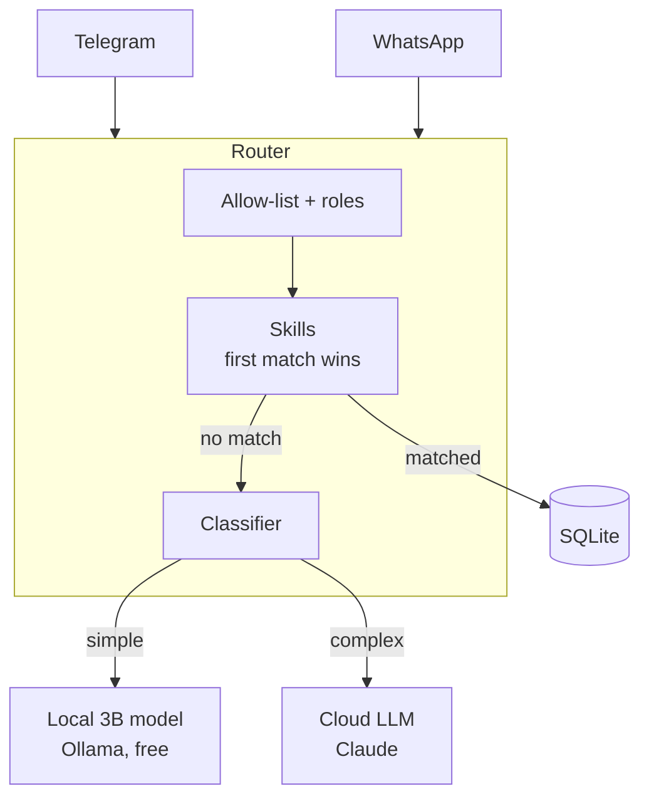

# HomeAgent

**A self-hosted household assistant for messaging apps. Most messages are answered for free by plain code or a local model, and only the hard ones go to a cloud LLM.**

It runs 24/7 on an 8 GB Apple Silicon Mac mini and serves a two-person household. Data stays at home in SQLite.

> This repository is an overview of the project. The source code is private.

---

## What it does

- **Splits shared expenses.** "I paid 40 for groceries" is recorded, and the bot replies with who owes whom.
- **Keeps a shared schedule.** "Pickup Thursday 17:00 school" or "who has the kids tomorrow?"
- **Reports the weather** for two locations.
- **Chats.** Anything no feature claims goes to a local model or a cloud LLM.
- **Restricts access by role.** Each person gets a role, and each feature can be limited to certain roles.

---

## Each message takes the cheapest path that can answer it

1. **Skills first, at no cost.** Expenses, schedule and weather are handled by plain Python code. The local model only helps pull amounts and names out of free text, with a regex fallback if it fails.
2. **Local model second.** Greetings and short questions go to a 3B model on the Mac through Ollama.
3. **Cloud model last.** Long or multi-step requests go to Claude. If the local classifier fails, the message also goes to the cloud, so users always get an answer.

The result is a monthly cloud bill of a few dollars or less for two people.

---

## Design choices

| Choice | Why |
|---|---|
| **Channel-agnostic router** | Telegram is live and WhatsApp is built in but switched off. A new messaging app is one adapter file, and the router never changes. |
| **Skills as plugins** | Each feature implements `matches()` and `handle()` and is registered in one list. No feature-specific branches in the router. |
| **Permissions in the router** | Skills declare allowed roles and the router enforces them. A denied request never falls through to a model, so nothing leaks. |
| **Polling, not webhooks** | Telegram long polling needs no public URL, tunnel or open port. |
| **Built for 8 GB RAM** | One resident 3B model uses about 3 to 4 GB. No heavy frameworks, only FastAPI, httpx and the model SDKs. |
| **No risky powers** | No shell access, browser automation or self-writing code. It stays a small, predictable tool. |

---

## Tech stack

| Layer | Technology |
|---|---|
| Messaging | Telegram Bot API (long polling), WhatsApp Cloud API (webhook) |
| App | Python 3.12, FastAPI, Uvicorn |
| Local model | Ollama with Llama 3.2 3B |
| Cloud model | Anthropic Claude |
| Storage | SQLite |
| Runtime | macOS launchd with `caffeinate`, restarts on crash and at boot |
| Extras | Voice endpoint with Whisper for a Raspberry Pi client, usage dashboard |

---

## Known limits

- **Text only.** Photos and voice notes in chat are ignored for now.
- **Chat history is in memory** and resets on restart. Expenses and schedules persist.
- **A home machine is a single point of failure.** Power cuts and OS updates take it down, which is acceptable for two people.

---

## Roadmap

- Weekly expense summary sent to both people automatically
- Chat history stored in SQLite so conversations survive restarts
- Receipt photos read by a vision model
- More skills, such as reminders

---

## License

[MIT](LICENSE)
